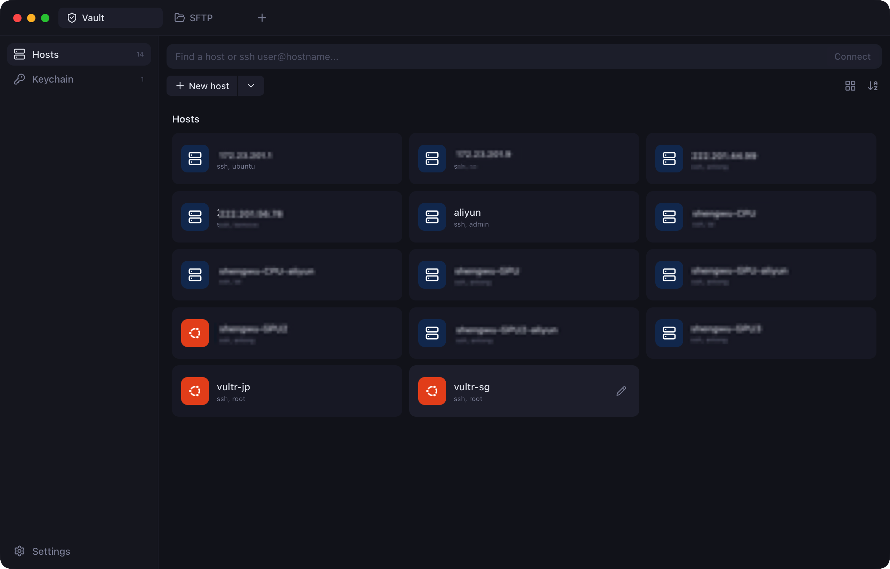
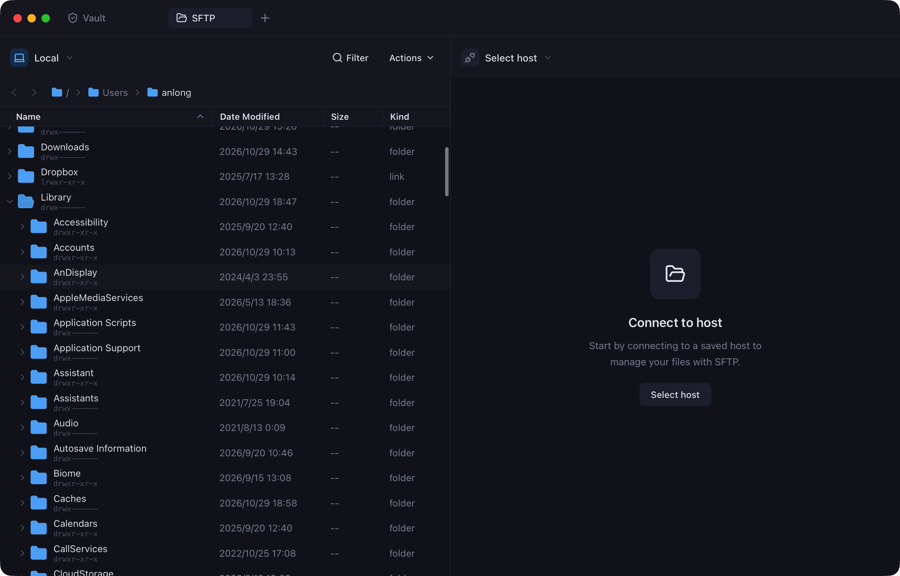
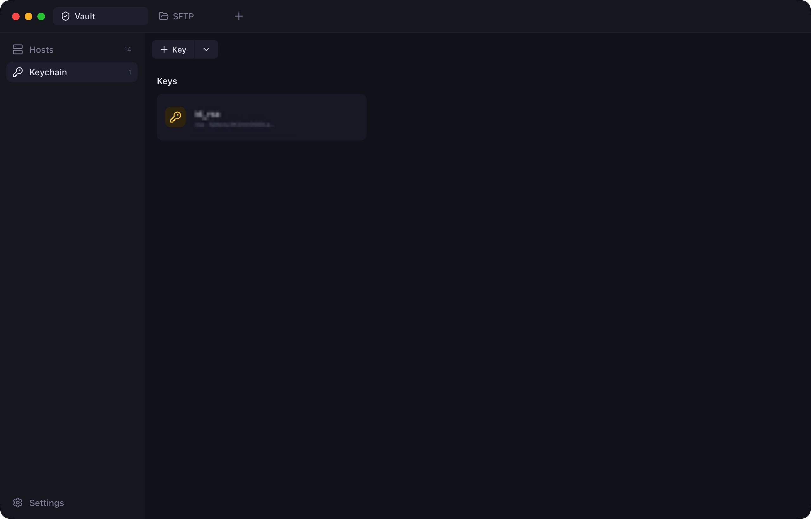

<p align="center">
  
</p>

<h1 align="center">Knot</h1>

<p align="center">
  A modern SSH and SFTP client for macOS, with a Finder-style file browser.<br>
  Built with Tauri 2, Rust and React.
</p>

<p align="center">
  
</p>

## Features

**Terminal**
- xterm.js with the WebGL renderer, search (<kbd>⌘F</kbd>), clickable links (<kbd>⌘</kbd>-click) and Unicode 11 widths
- Output is streamed over a binary Tauri `Channel`, not the event bus, so `cat` on a large file stays smooth
- Multiple sessions in tabs; each session stays alive when you switch tabs
- Split view: drag a tab onto another terminal to place it side by side (up to 4 panes). Tabs merge into a renamable **Workspace**; resize, maximize or drag panes back out to their own tab. Sessions keep running while you move them
- **Local** terminal pinned at the top of the host list: your login shell in a real PTY, next to your SSH sessions
- Seven color schemes (plus one that follows the app appearance), configurable font, cursor and scrollback; changes apply to open terminals immediately

**Vault**
- Saved hosts with alias, address, port, user, password and key; distro icons are detected automatically after the first connection
- Keychain for private keys: paste one, reference a file, or generate Ed25519 (optionally passphrase-protected)
- Passwords and passphrases are kept in the **macOS Keychain** (Windows Credential Manager on Windows), never in plain files
- One-click import from `~/.ssh/config`; quick connect with `user@host[:port]` from the search bar

**SFTP**
- Two panes: Local on the left, any saved host on either side
- Finder-style list view: disclosure arrows expand folders in place, double-click opens a folder, <kbd>Space</kbd> opens Quick Look (images and text)
- Drag and drop: drop within a pane to **move**, across panes to **copy**. Hovering over a folder while dragging expands it, and lists scroll when you drag near the edge
- Drag files in from Finder to upload them
- Multi-select, keyboard navigation, type-to-select, inline rename, new folder, delete and a transfer queue with progress and cancel

**Security**
- Host keys are checked against `~/.ssh/known_hosts` and Knot's own `known_hosts`. A new host prompts you with its SHA256 fingerprint; a changed key refuses the connection
- Authentication tries the host's key, then the SSH agent and `~/.ssh/id_*`, then password and keyboard-interactive

**Keyboard shortcuts**: open the host picker, new local terminal, close tab, switch tabs, find, clear and font size, all rebindable. Start from a preset modeled on Knot, iTerm2 / Terminal, Xshell or Windows Terminal.

**Settings**: light, dark or follow-system appearance, accent colors, interface font and size, terminal, SFTP and connection options (timeout, keepalive, agent).

<p align="center">
  
</p>

<p align="center">
  
</p>

## Install

Download the `.dmg` from [Releases](../../releases), open it and drag **Knot** into Applications.

Builds are not code-signed yet, so macOS blocks the first launch. To allow it, open **System Settings → Privacy & Security** and click **Open Anyway**, or run:

```bash
xattr -cr /Applications/Knot.app
```

When Knot first saves a password, macOS asks whether it may use the Keychain; choose **Always Allow**.

## Build from source

Prerequisites:

- [Rust](https://rustup.rs) (stable)
- Node.js 20+
- macOS: Xcode Command Line Tools (`xcode-select --install`)
- Windows: Microsoft C++ Build Tools and WebView2 (see the [Tauri prerequisites](https://tauri.app/start/prerequisites/))

```bash
npm install
npx tauri dev      # run in development mode
npx tauri build    # produce Knot.app and a .dmg in target/release/bundle/
```

> If the build fails with *"You have not agreed to the Xcode license agreements"*, run `sudo xcodebuild -license`, or build with the Command Line Tools instead: `export DEVELOPER_DIR=/Library/Developer/CommandLineTools`.

## Architecture

```
crates/knot-core/   SSH/SFTP core, independent of Tauri (unit-testable, reusable from a CLI)
  ssh.rs            connect, host-key verification, auth, shell, exec, SFTP channel
  pty.rs            local shell in a pseudo-terminal
  fs.rs             one file-system interface over local disk and SFTP; recursive copy with progress
  vault.rs          hosts, keys and settings (JSON) + secrets in the OS credential store
  keys.rs           key parsing, fingerprinting, Ed25519 generation
  sshconfig.rs      ~/.ssh/config import
src-tauri/          Tauri app: commands, session registry, host-key prompt bridge
src/                React + TypeScript UI (Tailwind CSS, Radix primitives, zustand)
  views/            Vault, Keychain, Settings, Terminal, SFTP panes
  lib/drag.ts       pointer-based drag & drop with spring-loaded folders
  lib/keymap.ts     shortcut presets, parsing and validation
  lib/panes.ts      split-view layout tree (up to 4 panes per workspace)
```

| Layer | Libraries |
| --- | --- |
| SSH / SFTP | [russh](https://github.com/Eugeny/russh), [russh-sftp](https://github.com/AspectUnk/russh-sftp) |
| Local terminal | [portable-pty](https://github.com/wezterm/wezterm/tree/main/pty) |
| Config & secrets | [ssh2-config](https://github.com/veeso/ssh2-config), [keyring](https://github.com/open-source-cooperative/keyring-rs) |
| App shell | [Tauri 2](https://tauri.app) |
| UI | React 19, [xterm.js](https://xtermjs.org), Tailwind CSS 4, Radix UI, lucide icons |

App data (hosts, key references, settings, Knot's `known_hosts`) lives in `~/Library/Application Support/dev.knot.desktop/`.

## Testing

```bash
cargo test --workspace        # unit tests
npx tsc -p tsconfig.json      # type-check the UI
```

The end-to-end test in `crates/knot-core/tests/live_ssh.rs` covers host-key trust, shells, encrypted keys and SFTP round trips against a real server. It is skipped unless you configure it:

```bash
KNOT_TEST_HOST=127.0.0.1 KNOT_TEST_PORT=2222 KNOT_TEST_USER=$USER \
KNOT_TEST_KEY=/path/to/unencrypted_key \
KNOT_TEST_KEY_ENC=/path/to/encrypted_key KNOT_TEST_KEY_PASS=secret \
cargo test -p knot-core --test live_ssh
```

The server must share the local file system (for example an unprivileged `sshd` on localhost).

## Roadmap

- [ ] Port forwarding (local / remote / dynamic)
- [ ] ProxyJump / jump hosts
- [ ] Share one connection between a host's terminal and SFTP sessions
- [ ] Snippets
- [ ] Signed and notarized macOS builds
- [ ] Verified Windows builds (the code is cross-platform but untested there)
